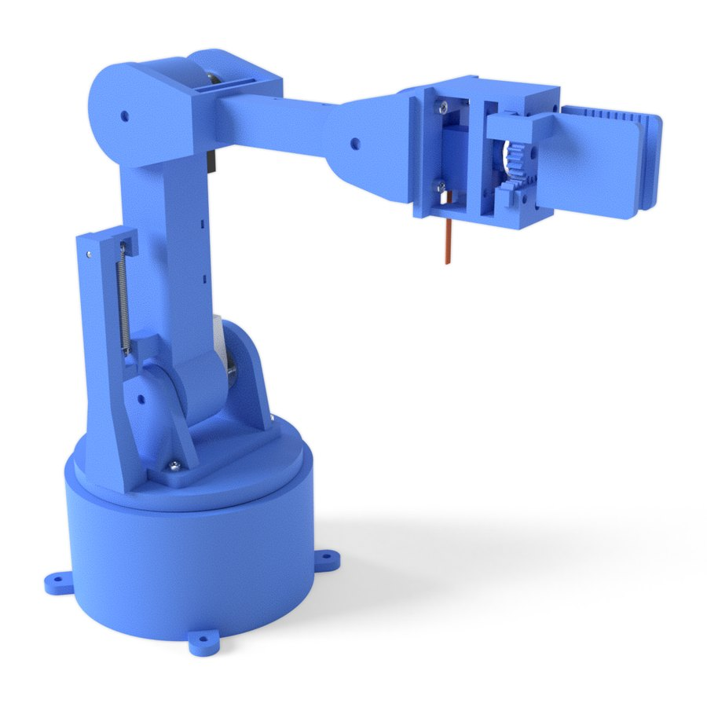
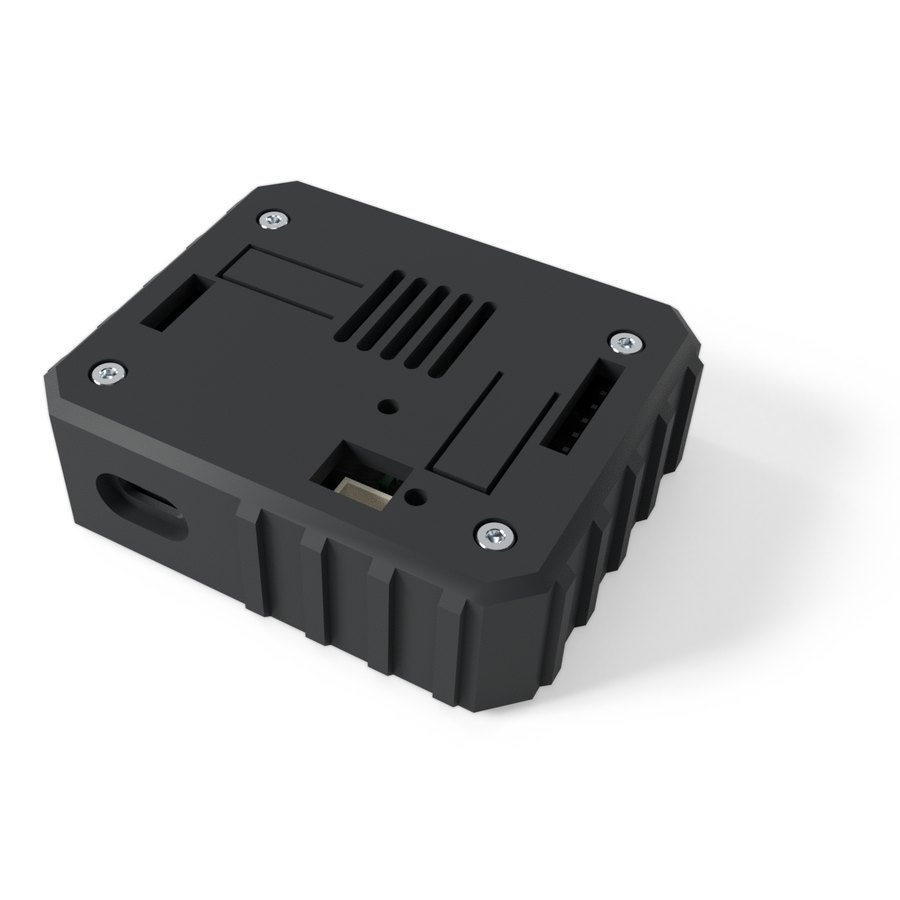
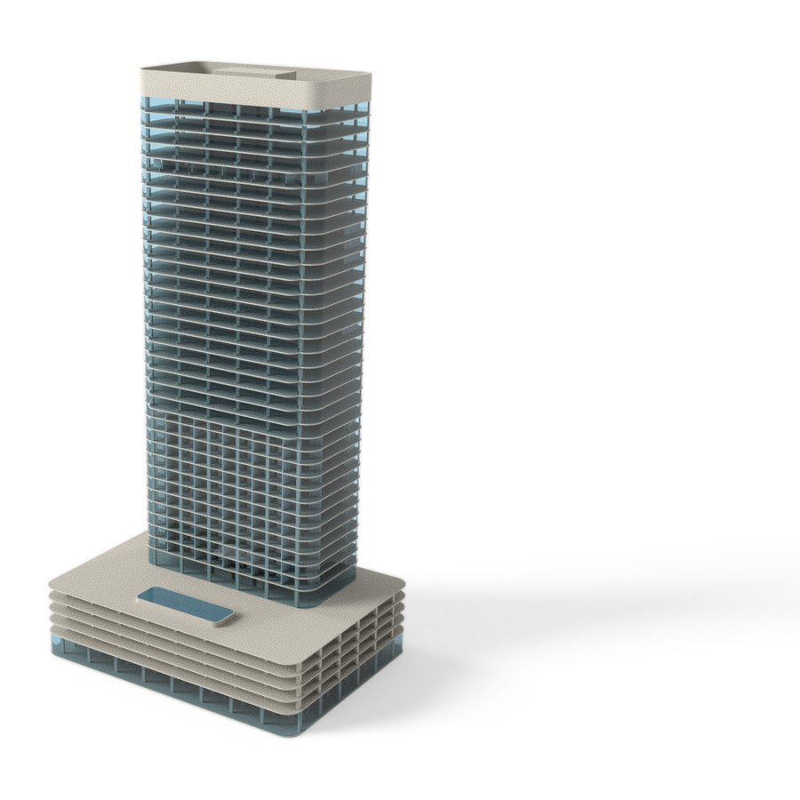
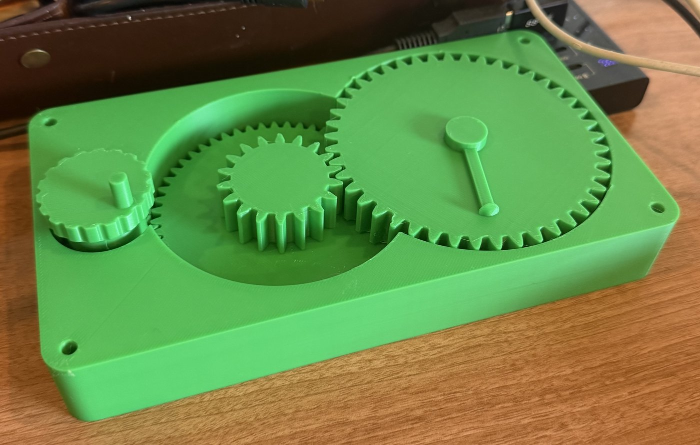

# Iṣẹ́ Studio

**One AI-native engineering studio for whole products: mechanical parts and assemblies, printed circuit boards, buildings, drawings, simulation, photoreal renders and 3D for the web, in one project, on one engine.** You describe what you want; the AI designs it, the engine checks it, and every change is one undoable revision you watch happen live.

*Iṣẹ́* (ee-sheh) is Yoruba for "work".

<table>
<tr>
<td align="center"><br><sub>Robot arm: printed parts, bought servos, joints, reach and torque checks</sub></td>
<td align="center"><br><sub>ESP32 board designed, routed and checked, in the enclosure built around it</sub></td>
<td align="center"><br><sub>A tower: levels, rooms, schedules and IFC</sub></td>
</tr>
</table>

## From the screen to a real part



A two-stage **print-in-place gear reducer**, designed in Iṣẹ́ Studio and printed in one piece on a Bambu Lab X1 (PLA, 0.2 mm layers, no supports). It came off the bed and turned: one short break-in turn, then smooth. The housing, every gear and the knob print together and never fuse.

- **Herringbone (V) teeth** lock each gear to its mate, so the train cannot slide apart, and print without supports at 30°.
- **Every gear stands on the bed** and every bottom edge is chamfered, so the first layer cannot weld neighbours together.
- **Checked before printing:** the engine's gear check turned the train through a full revolution and found at least 0.30 mm between moving parts everywhere. The clearances it used (0.4 mm running, 0.4 mm between layers) worked on the first print.

The AI didn't pick features from a menu: it wrote the gearbox as a program (involute teeth, the twist, the clearances as parameters), and the engine proved the moving parts never touch. The same approach is in [`examples/gearbox-print`](examples/gearbox-print/print-in-place.js), ready to load and change, and its [3MF is ready to print](examples/gearbox-print/print/), with the lithophane lamp, the relief plaque and the robot arm's 17 parts: [printable examples](examples/README.md#ready-to-print).

## What it does

- **Mechanical design**: exact solids (OpenCascade), sketches with constraints, fillets, sweeps and lofts, surfaces, sheet metal, threads and lettering, assemblies with joints, motion and clash checks, fit checks for screws, inserts and bearings.
- **Electronics**: schematics, all of KiCad's libraries, layout, autorouting, impedance and length rules, DRC with fab limits, SPICE simulation, and every fabrication output, checked by reading the Gerbers back.
- **Buildings**: levels, rooms, schedules, plans and IFC.
- **Simulation**: stress, buckling, fatigue, heat, vibration, mechanisms and robot reach.
- **Drawings**: dimensions, fits, threads, sections and GD&T.
- **From photos**: model from reference photos, and turn photos into 3D scans (photogrammetry).
- **Making and buying**: a BOM with costs, suppliers and quotes; stock parts from real catalogues; files for 3D printers, laser cutters and fabs.
- **Pictures**: photoreal product renders, and 3D models for websites with AR on phones.
- **Working together**: real-time collaboration, peer to peer; versions and branches.
- **For AI assistants**: Claude in Chrome (`window.ise`), Claude Desktop, Claude Code, Codex and Cursor (an MCP server), with a skill generated from the code.

## How it compares

Our assessment of where Iṣẹ́ Studio stands today. ✅ yes · ◐ partial · ❌ no · ⏸ planned, not started.

### Electronics: Iṣẹ́ Studio vs KiCad, Altium, Cadence

| Feature | **Iṣẹ́ Studio** | KiCad | Altium | Cadence |
|---|---|---|---|---|
| Price | Free | Free | ~$4–10k/yr | ~$2–50k+/yr |
| Schematic capture, hierarchy, buses, ERC, field editor, net classes | ✅ | ✅ | ✅ | ✅ |
| SPICE simulation | ✅ ngspice | ✅ | ✅ | ✅ |
| Part library (all of KiCad's), checked against KiCad | ✅ | ✅ | ✅ | ✅ |
| Symbol and footprint editors, IPC-7351 wizards | ✅ | ✅ | ✅ | ✅ |
| Autorouter + push-and-shove router, fan-out | ✅ | ✅ (no autorouter) | ✅ | ✅ |
| Routing constraints: impedance from the stackup, diff pairs, length tuning | ✅ | ✅ | ✅ | ✅ |
| DRC, custom rule language, fab-specific checks | ✅ | ✅ (no fab checks) | ◐ | ◐ |
| 2–32 layers, blind/buried/micro vias, stackup editor | ✅ | ✅ | ✅ | ✅ |
| Gerber X2, drill, IPC-2581, ODB++, IPC-D-356, pick-and-place, STEP | ✅ | ✅ | ✅ | ✅ |
| Gerber read-back check | ✅ | ❌ | ◐ | ◐ |
| Import from KiCad, Eagle, EasyEDA, Altium, CADSTAR, PADS, gEDA | ✅ | ✅ | ◐ | ◐ |
| Board inside its enclosure: one model, one BOM | ✅ | ◐ | ◐ | ◐ |
| AI designs and verifies the board | ✅ | ❌ | ◐ | ◐ |
| Real-time multi-user | ✅ | ❌ | ◐ | ◐ |
| Signal/power integrity, EMC, thermal | ❌ | ❌ | ◐ | ✅ |

### Mechanical: Iṣẹ́ Studio vs FreeCAD, Fusion, SolidWorks, Shapr3D, Rhino, Inventor, AutoCAD

| Feature | **Iṣẹ́ Studio** | FreeCAD | Fusion | SolidWorks | Shapr3D | Rhino | Inventor | AutoCAD |
|---|---|---|---|---|---|---|---|---|
| Price | Free | Free | ~$680/yr | ~$2.8k/yr | ~$300/yr | ~$1k | ~$2.7k/yr | ~$2k/yr |
| Sketcher (conics, B-splines, all constraints, conflict report) | ✅ | ✅ | ✅ | ✅ | ✅ | ✅ | ✅ | ✅ 2D |
| Exact loft, sweep, helix, pipe, offset, thicken, variable fillets | ✅ | ✅ | ✅ | ✅ | ◐ | ✅ | ✅ | ❌ |
| Advanced surfaces (G2 fill, network, blend, sew, zebra) | ✅ | ◐ | ✅ | ✅ | ◐ | ✅ | ◐ | ❌ |
| Assembly mates, couplings, DoF report, interlocks | ✅ | ✅ | ✅ | ✅ | ◐ | ❌ | ✅ | ❌ |
| Collision through motion, interference, fit checks | ✅ | ◐ | ◐ | ✅ | ❌ | ❌ | ✅ | ❌ |
| Motion studies, exploded views, robot kinematics | ✅ | ◐ | ✅ | ✅ | ❌ | ❌ | ✅ | ❌ |
| Stock parts with suppliers, BOM with costs and quotes | ✅ | ◐ | ◐ | ◐ | ❌ | ❌ | ◐ | ❌ |
| 2D drawings (dimensions, fits, threads, sections, GD&T, welds) | ✅ | ✅ | ✅ | ✅ | ◐ | ◐ | ✅ | ✅ |
| Stress, buckling, fatigue, contact, heat, beams and plates | ✅ | ✅ | ✅ | ✅ | ❌ | ❌ | ✅ | ❌ |
| Sheet metal (flanges, flat pattern, bend table) | ✅ | ◐ | ✅ | ✅ | ❌ | ❌ | ✅ | ❌ |
| Model from reference photos (calibrated canvases, silhouette checks) | ✅ | ◐ | ✅ | ◐ | ◐ | ◐ | ◐ | ◐ |
| Photogrammetry: photos to a sized 3D scan | ✅ | ❌ | ◐ | ❌ | ❌ | ❌ | ❌ | ◐ |
| Mesh repair, point clouds, scan fitting, deviation | ✅ | ✅ | ◐ | ◐ | ❌ | ✅ | ◐ | ❌ |
| Buildings: levels, rooms, schedules, plans, IFC | ✅ | ✅ | ❌ | ❌ | ❌ | ◐ | ❌ | ◐ |
| Items from other projects, linked or copied | ✅ | ◐ | ✅ | ✅ | ◐ | ✅ | ✅ | ✅ |
| File formats: STEP, IGES, STL, OBJ, PLY, glTF, 3MF, DXF, SVG, IFC | ✅ | ✅ | ✅ | ✅ | ✅ | ✅ | ✅ | ✅ |
| Photoreal rendering and web 3D (glTF with materials, AR) | ✅ | ◐ | ✅ | ✅ | ✅ | ✅ | ✅ | ◐ |
| 3D printing (print-in-place rules, 3MF, send to the slicer) | ✅ | ◐ | ✅ | ◐ | ◐ | ◐ | ◐ | ❌ |
| Large assemblies (10,000 parts at 75 fps) | ✅ | ◐ | ✅ | ✅ | ◐ | ◐ | ✅ | ◐ |
| CAM / CNC | ⏸ | ✅ | ✅ | ◐ | ❌ | ◐ | ◐ | ❌ |
| Real-time multi-user | ✅ | ❌ | ✅ | ❌ | ◐ | ❌ | ❌ | ◐ |
| AI that builds and verifies whole products | ✅ | ◐ | ◐ | ◐ | ❌ | ❌ | ◐ | ◐ |

## Quick start

```sh
brew install opencascade node pnpm            # plus Rust: https://rustup.rs
git clone https://github.com/JacLight/ise-studio.git && cd ise-studio
cd apps/web && pnpm install && pnpm build && cd ../..
cargo build --release -p de-server
./target/release/de-server --project projects/default.jsonl --web apps/web/dist
```

Open **http://127.0.0.1:7420**. Everything runs on your computer. [Full setup](docs/getting-started.md), including the optional built-in assistant (Claude Code), circuit simulation and photogrammetry.

## Documentation

- [Getting started](docs/getting-started.md)
- [AI assistants](docs/ai-assistants.md): Iṣẹ́ AI, Claude in Chrome, and MCP for Claude Desktop, Claude Code, Codex and Cursor
- [Renders and 3D for the web](docs/rendering-and-web-3d.md)
- [How it is built](docs/architecture.md) · [Contributing](docs/contributing.md)
- Generated from the code: [the skill](skills/ise-studio/SKILL.md), [every operation](skills/ise-studio/reference/operations/), [the command line](skills/ise-studio/reference/cli.md), [the HTTP API](skills/ise-studio/reference/http.md)

The product specification and design rationale: [SPEC.md](SPEC.md) · [DESIGN.md](DESIGN.md) · [BUILD_PLAN.md](BUILD_PLAN.md).
