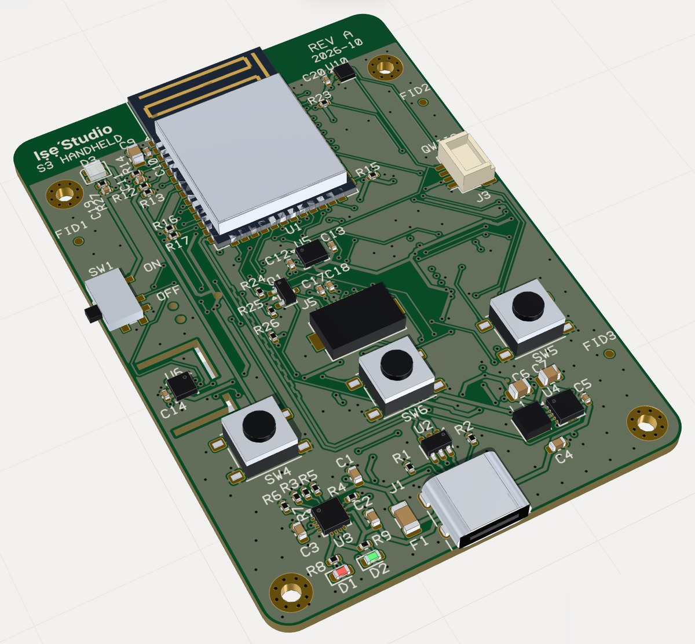
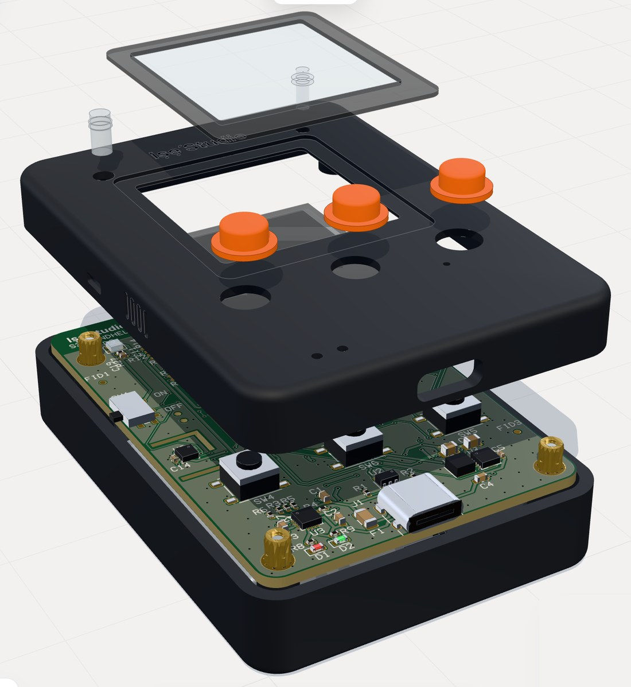

# Examples

Each folder is a finished design as a step list (`steps.json`, plus the shape programs it uses). Load one into a project with:

```sh
node tools/ise.mjs run examples/<folder>/steps.json --project <name>
```

then open `http://127.0.0.1:7420/?project=<name>`. Change its parameters there, or ask Iṣẹ́ AI to, and export again.

## Ready to print

These folders also carry a `print/` folder of files exported from the design, so you can go straight to the slicer (Bambu Studio, OrcaSlicer, PrusaSlicer, Cura). Every file is in millimetres and already lies the way it prints. All fit a 256 mm bed (Bambu Lab X1/P1, 0.4 mm nozzle, PLA). The gear reducer has been printed and turned; the others are fresh from the design, so tell us how yours come out.

| Example | Files | Size (mm) | How to print |
|---|---|---|---|
| [Print-in-place gear reducer](gearbox-print/) | `print-in-place-reducer.3mf` | 188 × 103 × 49 | One piece, **no supports**: the exact design that was printed. 0.4 mm clearance between moving parts and 0.4 mm between layers. When it's done, work the knob back and forth once to break it free; then it turns smoothly at 1 : 7.5. |
| [Lithophane lamp](lithophane/) | `lighthouse-panel.3mf` (white PLA), `lighthouse-base.3mf` (black PLA) | panel 150 × 3 × 113, base 174 × 64 × 22 | Print the panel **standing up as it lies in the file**, with a brim and 100 % infill so every thickness shows; slow outer walls help. The base prints flat, no supports. Slide the panel into the slot and put two tea lights (LED) in the pockets behind it. |
| [Relief plaque from a photo](relief-from-photo/) | `valley-relief-plaque.3mf` | 180 × 120 × 7 | Face up, no supports. Finer layers (0.12 mm) bring out more detail. The keyhole slots on the back hang it on two screws. |
| [Desktop robot arm](robot-arm/) | 17 `.3mf` files, one per printed part | up to 173 long (upper arm halves) | Every part is already in its print orientation; the first lines of its program in `programs/` say which face goes on the bed. PLA, 4 walls, 30 % infill for the base, turntable, yoke and arm halves. Then the bought parts below. |

### Robot arm: bought parts

| Part | Qty |
|---|---|
| MG996R servo (base, shoulder, elbow), with a 25-tooth Ø24 disc horn | 3 |
| MG90S servo (wrist, gripper), with a 20-tooth Ø16 disc horn | 2 |
| 6807-2RS bearing (35 × 47 × 7, turntable) | 1 |
| 608-2RS bearing (8 × 22 × 7, shoulder) | 2 |
| 625-2RS bearing (5 × 16 × 5, wrist) | 1 |
| Dowel pin ISO 8734, Ø8 × 16 (shoulder) | 2 |
| Dowel pin ISO 8734, Ø5 × 16 (wrist) | 1 |
| Heat-set insert M3 × 5.7 | 28 |
| Heat-set insert M3 × 3 (short, finger pivot) | 1 |
| Heat-set insert M2 × 4 | 12 |
| Socket head cap screw ISO 4762, M3 × 6 / 8 / 10 / 12 / 14 / 18 / 20 / 35 | 3 / 12 / 4 / 6 / 4 / 4 / 5 / 6 |
| Socket head cap screw ISO 4762, M2 × 5 / 6 / 8 | 2 / 20 / 4 |
| Flat washer ISO 7089, M2 | 12 |

Load the design (`node tools/ise.mjs run examples/robot-arm/steps.json --project robot-arm`) to see where every part goes, in the exploded view, and to get every part's STEP as well: **Export → Fabrication package** (`node tools/ise.mjs export "Robot arm" --format zip`).

## Electronics: ESP32-S3 handheld

[`esp32-s3-showcase/`](esp32-s3-showcase/) is a product mainboard and the case around it, in one project:

- **Board**: 50 × 72 mm, 4 layers (JLCPCB JLC04161H-7628 stackup: signal, solid GND, 3V3 plane, signal), 1.6 mm, ENIG, 95 parts on both sides, all KiCad library symbols and footprints. ESP32-S3-WROOM-1 (antenna over a keepout at the top edge), USB-C with USBLC6 ESD and a 90 Ω D+/D− pair (skew 0.000 mm), BQ24074 charger with power path, TPS63001 3.3 V buck-boost, LC709203F fuel gauge, LSM6DS3TR-C IMU, BME280 on a slotted island, LTR-303 light sensor, MAX98357A amplifier and ICS-43434 microphone (I²S), 4-bit microSD, 1.54" TFT on an FPC, Qwiic, RGB status LED, three buttons, power switch, Tag-Connect, test points, fiducials.
- **Checks**: ERC 0, DRC 0 errors (59/59 nets routed; 11 thermal-relief warnings on crowded passive pads), Gerber read-back matches the board, JLCPCB's 4-layer limits met. `fab/` is the JLCPCB package (Gerbers, drills, BOM, positions, impedance notes).
- **Case**: two printed shells joined by four M2 × 12 screws into heat-set inserts that clamp the board, button caps, light pipes, a printed cover lens, the display module, a 503040 cell and a 13 mm speaker. Set the case's `explode` parameter (e.g. 18) to open it.

```sh
node tools/ise.mjs run examples/esp32-s3-showcase/steps.json --project esp32-s3-showcase
```



